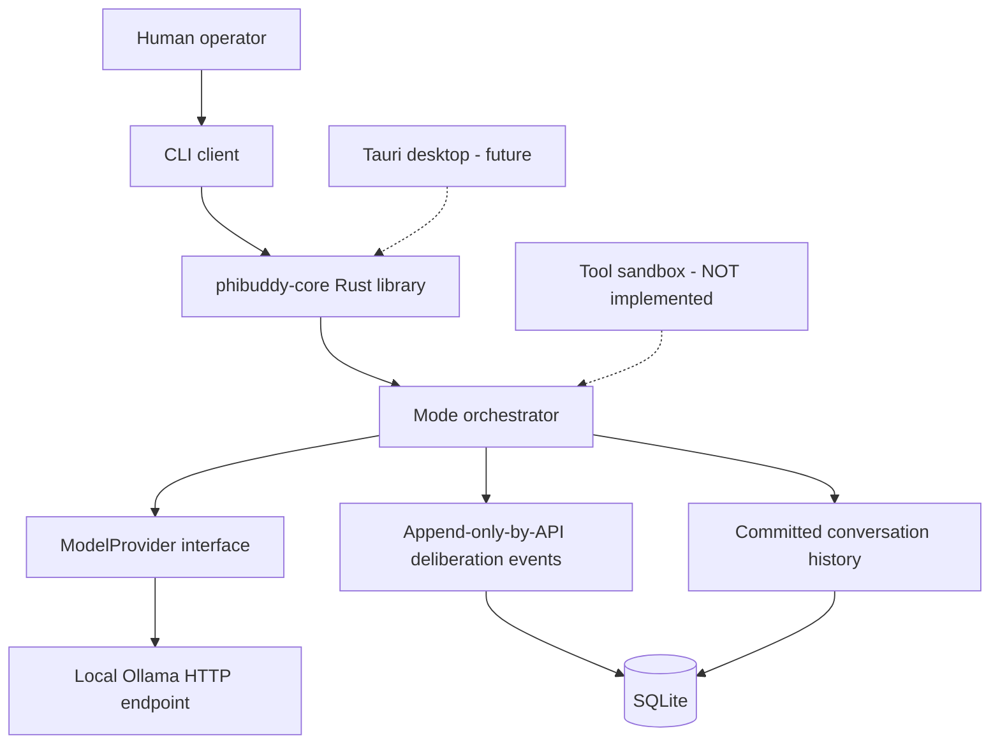

# PhiBuddy Architecture, v0.2 (architecture decision record)

## Source of decisions

Three architecture proposals from Grok, Claude, and Hydrogen (Gemini) were reviewed against the *actual* v0.1.1 Rust CLI, which the user compiled and tested on Windows (six tests passed, Ollama reachable, live inference confirmed). The reports are recommendations, **not implementation evidence**. This document is a constrained consensus, not a claim that the larger system already exists.

### Confirmed decisions

| Decision | v0.2 choice | Reason / validation |
| --- | --- | --- |
| Core | Reusable Rust `phibuddy-core` | The existing CLI already calls the core; Tauri can do the same. |
| Model | One local Ollama model sequentially | Fits the 12 GB VRAM starting point; actual latency/VRAM must be measured. |
| Agents | Three stable prompts/roles; Solo, Quick Council, Debate Council, Workshop | A persona is not a separate trained model. Stage-by-stage events expose what actually happened. |
| Persistence | SQLite event log alongside backward-compatible conversation tables | Retains v0.1 sessions, preserves partial work when a model call fails. |
| Security | No executable tools or remote endpoints in v0.2 | Keeps privileges absent until a dedicated policy, approvals, and sandbox exist. |
| Desktop | Tauri 2 shell planned, not implemented | Keep core usable in CLI, choose accessible panel UI first. |
| Frontend | React vs. Svelte **not decided** | Benchmark a small panel prototype; consider user ecosystem and accessibility, not unsupported crash claims. |
| Daemon | Not yet | An embedded core is simpler; only add host/IPC when concurrent clients justify it. |
| Memory | Events and raw conversation; provenance-backed derived memory deferred | No hallucinated automatic memory, no silent pruning. |
| External integrations | PhiServe / Agentora / PhiMemory9 via future *documented* versioned ports | Avoid assuming those repos have matching APIs. |

## Current implementation topology

- v0.2 provides **one new table**, `deliberation_events`, with a monotonically increasing sequence, schema version, session ID, turn ID, kind, agent identity, content, and time.
- Each stage is committed when complete. On provider failure, a `turn_failed` event is appended and earlier events remain; no incomplete user/assistant pair enters future model context.
- A successful turn commits user input, contribution messages, final answer, and terminal `turn_completed` event in one SQLite transaction.
- Event traces are **not** tamper-evident yet; local users and OS software with database access can modify them. Cryptographic audit chaining is a separate later feature.
- v0.1 databases remain readable: schema changes are additive. Database backup before upgrading is still recommended. No deletion or compaction is implemented.
- Text outputs are original model responses, never fabricated from the final synthesis. They are not proof that the claims made within are factual.

## Council protocol

- **Quick:** each agent independently gets the same original question and prior *final* chat history; Buddy synthesizes. Four model calls.
- **Debate:** three independent drafts, then each role receives only its own original draft and the other two drafts for a cross-critique, then Buddy synthesizes drafts and critiques. Seven model calls.
- No agent's independent draft gets another draft as input. No model execution happens simultaneously. Council responses are not evidence of model diversity when the same model hosts all roles.
- Full drafts are stored; synth context truncates any one draft/critique after 12,000 Unicode characters, with a visible truncation notice. 20,000-character input limit reduces runaway requests.
- Failure or cancellation controls are rudimentary: the blocking Ollama call has a 180-second HTTP timeout. Streaming and cancel tokens are future features.

## Security boundaries

1. There is **no** shell, filesystem edit, Git, network tool, MCP tool, or plugin executor exposed to agents.
2. CLI validates that the Ollama endpoint is loopback HTTP (`127.0.0.1`, `localhost`, `::1`). Ollama itself is an independent process; other programs can reach it if configured to listen externally.
3. SQLite data and deliberation logs are local, **not encrypted**. Personal prompts may contain sensitive information; users should apply OS disk permissions and backups accordingly.
4. Agent messages may contain prompt injection or misinformation, so their text is handled as reference data, not executable instructions. This is **not** a complete prompt-injection defense.
5. Future capabilities must be gated by policy outside the model: read, propose, reversible execute, consequential execute. Before a real executor ships, introduce scoped permissions, reviewable diffs, tested Windows isolation, and audit records.
6. Cloud adapters, ambient secrets, telemetry, automatic installations, and autonomous repo writes are excluded.

## Future bounded phases (not implemented)

- **v0.3:** Tauri 2 accessible panel workbench, real streaming/cancellation; local hardware benchmarks; mock provider testkit expanded.
- **v0.4:** backed-up schema migrations, FTS5 search, sourced memory proposals and review, JSONL import, export; user-controlled deletion semantics.
- **v0.5:** deny-by-default capability policy crate and read/propose-only tools, policy property tests, prompt-injection regression suite.
- **v0.6:** staged filesystem/Git executor, Windows sandbox validation, human approval UI; MCP in constrained child process.
- **v0.7+ (conditional):** replay/fork, provider routing, spatial Workshop, optional PhiOS adapters, evaluation of mixed-model councils.

Release numbering is about **verified exit criteria**, not fixed calendar dates. Avoid 17 crates until those boundaries need separate versioning and tests.

## Validation gate before v0.3

1. `cargo fmt --all -- --check`, `cargo clippy --workspace --all-targets -- -D warnings`, `cargo test --workspace` on Windows and Linux CI.
2. Existing user database opens and retains v0.1 messages.
3. Quick mode records exactly 3 drafts and 1 synthesis, and no cross-critique.
4. Debate mode records exactly 3 drafts, 3 distinct critiques, and 1 synthesis.
5. The first three drafts do not see each other's outputs.
6. A simulated provider failure records partial events and does not add incomplete conversation history.
7. `events <session> --jsonl` produces valid independent records; no implicit telemetry or tool execution.
8. Live Windows Ollama smoke test including elapsed time, model name, GPU usage, and manual evaluation of answer fidelity.
